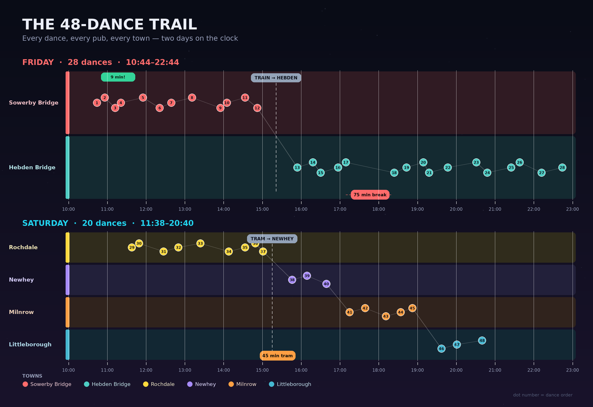

# 40 in 40 — Medlock Rapper

**Live report:** https://wolff-956.github.io/40in40/

A visual record of a weekend attempting **40 dances in 40 pubs in 40 hours** for Tom's 40th birthday.

## The challenge

Medlock Rapper set out to dance 40 dances in 40 pubs in 40 hours to mark Tom's 40th. We got a bit carried away and ended up dancing 48 times in 48 different pubs (plus one on a train and one on a tram), across Sowerby Bridge, Hebden Bridge, Rochdale, Newhey, Milnrow and Littleborough.

| Measure | Value |
|---|---|
| Dances / pubs | 48 / 48 |
| Towns | 6 |
| Named performers | 16 |
| Friday / Saturday | 28 / 20 |
| Clock time across both days | 21h 02m |
| Median gap between dances | 25.5 minutes |

The full write-up, charts and venue-by-venue detail are on the live site above.

## What's in this repo

- `index.html` — the report page served by GitHub Pages
- `01_timeline.png` … `08_codancers.png` — the charts
- `.nojekyll` — tells GitHub Pages to serve the files directly
- `README.md` — this file

## How it was made

The event was recorded in a simple CSV (`Day, Location, Dance, Pub, Time, Position 1–5, Tommy, Music`) and turned into charts with Python and Pillow. 
The site is plain HTML/CSS and is hosted on GitHub Pages. This was generated by DeepSeek v4.1 Flash.

The raw CSV is kept locally and is not part of this repo. Dancers are identified by first name only.

## Data notes

- `Position 1`–`5` are the five dancers in the set.
- `Tommy` is the lead role; where a second Tommy was listed, this was in fact a `Betty`.
- `Music` is recorded separately from the dancers.

## Credits

- **Medlock Rapper** — the dancers, musicians, Tommys and Bettys
- **Tom** — the birthday that started it
- The pubs and venues that put up with us

*This was a personal project, not an official Medlock Rapper publication.*
